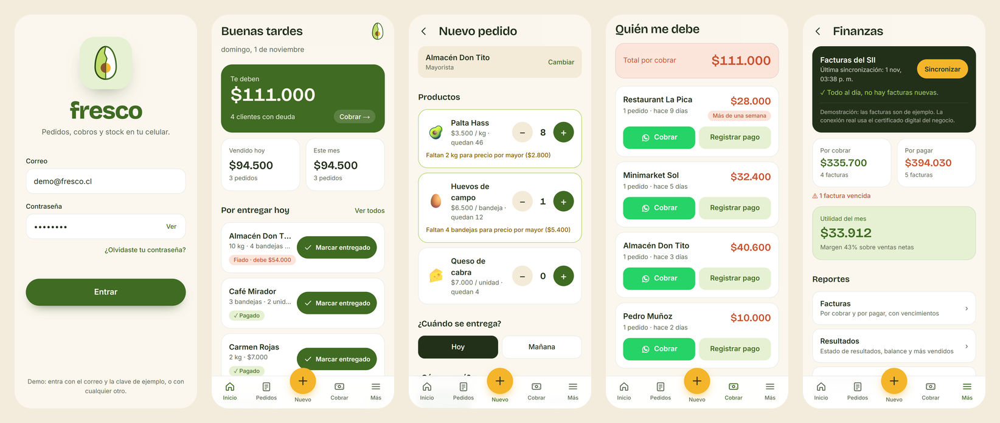

# Fresco

A mobile-first sales app for a small food business: a seller of avocados, eggs and goat cheese who works wholesale and retail and, until now, kept everything in a paper notebook.

**[Live demo →](https://fresco-demo-five.vercel.app)** · [Case study](https://consueloherreradesign.vercel.app/proyectos/fresco)



> Working prototype designed and built by [Consuelo Herrera](https://consueloherreradesign.vercel.app) as a proposal for a real business. The demo runs on sample data; the sync with Chile's tax office (SII) is simulated.

## What it does

- **Orders in seconds.** Pick a client, add products and save. Wholesale pricing kicks in automatically once a wholesale client reaches the minimum quantity.
- **Partial payments and debts.** Each order tracks delivery and payment separately ("paid $20,000 · owes $14,500"). A collections screen lists who owes what and since when, with a one-tap WhatsApp reminder.
- **Stock that updates itself** with every sale.
- **Finances in plain words.** Invoices to collect and to pay, an income statement, a simplified balance sheet, best sellers and a three-month sales projection.
- **Books for the accountant.** Sales, purchases and journal ledgers download as CSV files that open in Excel.
- **Installable.** It installs on the phone like a native app and keeps its data on the device.

## Stack

Next.js 16 (App Router) · React 19 · TypeScript · Tailwind CSS 4 · Web App Manifest (PWA) · deployed on Vercel.

Data lives in the browser's `localStorage` behind a single React context, so the prototype needs no backend.

## Code tour

| Where | What |
| --- | --- |
| `src/lib/tipos.ts` | Data model (products, clients, orders, invoices) and pricing rules such as `precioPara()` |
| `src/lib/calculos.ts` | Debts per client, sales by period, WhatsApp links |
| `src/lib/finanzas.ts` | Income statement, balance, best sellers, sales projection (least-squares trend) and CSV ledgers |
| `src/lib/datos.tsx` | State provider: orders, payments, stock and the simulated SII sync |
| `src/lib/ejemplo.ts` | Sample data for the demo |
| `src/components/ui.tsx` | Shared UI: screen layout, bottom navigation, cards, status labels |
| `src/app/*` | One folder per screen: orders, collections, clients, stock, finances, catalogue |

Names in the code follow the business vocabulary in Spanish (`pedido` = order, `cliente` = client, `deuda` = debt), the language the app is used in.

## Run it locally

```bash
npm install
npm run dev
```

Then open [http://localhost:3000](http://localhost:3000). "Más → Volver a los datos de ejemplo" resets the sample data.
